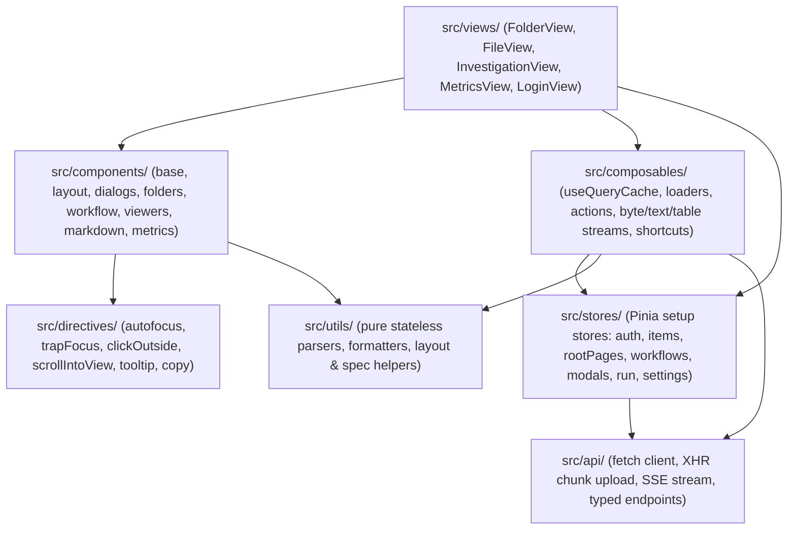

# Design: Runestone web UI

## Summary

Add `runestone` in `web/runestone/` as a new Vue 3, TypeScript, and Tailwind CSS v4 web UI with no component library and six runtime packages (`vue`, `vue-router`, `pinia`, `tailwindcss`, `@tailwindcss/vite`, `lucide-vue-next`). Runestone uses a high-density console layout, keyboard-first navigation, a stale-while-revalidate query cache for slow connections, and client-side HTTP `Range` file viewers behind a pluggable viewer registry. Both `sunstone` and `runestone` run side by side until Runestone reaches full feature parity with Sunstone and takes over `ghcr.io/openrelik/openrelik-ui` as the default UI.

## Background

`web/sunstone/` depends on Vuetify 3, `axios`, `lodash`, `marked`, `dompurify`, `resumablejs`, `mitt`, `apexcharts`, `vue3-apexcharts`, `uuid`, `@mdi/font`, `roboto-fontface`, and `sass`, mixing Vue Options API and Composition API without TypeScript. That stack creates three day-to-day problems for analysts and contributors:

- Material Design spacing, rounded cards, and page gutters reduce how many files, folders, and workflow tasks fit on screen at once.
- `File.vue` previews files through a server-rendered `<iframe>` (`GET /api/v1/files/{file_id}/content`), hard-capped at 10 MB, with Content and Details split into separate tabs and no hex or structured CSV/TSV/JSONL viewer.
- Every route transition refetches folder and workflow data without a shared cache or request cancellation, making navigation feel slow over VPNs and high-latency links.

A standalone prototype (`openrelik-new-ui`, ~65 commits) tested whether a zero-component-library Vue 3 + Tailwind CSS v4 architecture could replace all of those dependencies cleanly against the existing OpenRelik v1 REST API:

- Native `fetch` (plus one `XMLHttpRequest` upload path for byte-level progress) replaced `axios` and `resumablejs`, adding shared 401 token refresh, automatic CSRF fetch/retry, request timeouts, reachability tracking, and in-flight activity counts.
- Custom TypeScript modules replaced `marked` + `dompurify` (`utils/markdown.ts`), `apexcharts` (`components/charts/LineChart.vue`), `mitt` (Pinia setup stores and module-scoped composables), `uuid` (`crypto.getRandomValues` in `utils/id.ts`), and Popper/Floating UI (`utils/placement.ts`).
- Reading byte slices via `GET /api/v1/files/{file_id}/download` with HTTP `Range` headers (`206 Partial Content`) and rendering only visible fixed-height rows (`useRowScroller`) removed the 10 MB preview ceiling and opened multi-gigabyte files in constant memory.
- Parsing Markdown into a typed AST and rendering through Vue components (`vue/no-v-html` enforced by ESLint, HTML shown as source, links routed through an inspect/copy menu, external images never loaded) eliminated XSS and accidental outbound requests when viewing untrusted evidence.

## Proposal

### Console layout and visual system

The viewport spans edge-to-edge (`h-dvh`, no outer margin gutters) and every primary view follows a three-tier vertical layout:

```text
┌─────────────────────────────────────────────────────────────────────────────┐
│ 1. PATH BAR (40px)                                                          │
│    [Logo / Breadcrumb / Inline Prompt]   [Case Badge]      [View Actions]   │
├──────────────────────────────────────────────────────────────┬──────────────┤
│ 2. MAIN WORKSPACE (scrollable body)                          │ 2b. SIDE PANE│
│                                                              │  (resizable) │
│    Explorer table, workflow tree/flowchart, file viewer,     │              │
│    or metrics grid                                           │ Task or file │
│                                                              │ inspector    │
├──────────────────────────────────────────────────────────────┴──────────────┤
│ 3. STATUS BAR (28px)                                                        │
│    [Item/Byte Counts]        [Network / Upload State]   [Account / Settings]│
└─────────────────────────────────────────────────────────────────────────────┘
```

- Self-hosted IBM Plex Sans renders UI chrome and prose; self-hosted IBM Plex Mono (`font-mono`) renders data that analysts compare or copy character by character (filenames, paths, hashes, IDs, byte offsets, and viewer contents). No external font requests are made.
- Typography is restricted to four sizes (`14px` card titles, `13px` body, `12px` lowercase micro-labels, `11px` badges/status bar), with `font-variant-numeric: tabular-nums` on dynamic counters, sizes, and timestamps so values never shift adjacent layout.
- Corners stay tight (`2px`–`4px`, never pill-shaped). Buttons have five variants (`primary` at most once per screen, `brand`, `secondary`, `danger` outlined and never solid red, and `ghost`) and two heights (`32px` toolbar, `24px` table row).
- Light and dark themes use perceptually uniform OKLCH tokens (`data-theme="dark"` accents at `L = 0.82` with >10:1 contrast; `data-theme="light"` accents at `L = 0.449` clearing WCAG AAA 7:1 on white). Status badges use quiet tint fills and borders instead of solid saturated blocks.
- Every core flow works from the keyboard: arrow/cursor traversal and `Shift` range selection in tables, `⌘K` or `g` for the path/command prompt, `/` for filtering, `i` to toggle the inspector pane, `?` for `HelpDialog`, and a modal stack where `Escape` peels back the topmost active edit, popover, or dialog without side effects.

### Views, routes, and user workflows

| Route | View | User-visible behaviour |
| :--- | :--- | :--- |
| `/login` | `LoginView` | Local username/password sign-in plus OAuth/OIDC provider buttons configured via `VITE_OPENRELIK_AUTH_METHODS`, preserving `?redirect=`. |
| `/` | `FolderView` | Unified paginated root folder list (`?page=`, 25/40/100 per page) with owner avatars, case badges, and background next-page prefetch. |
| `/folder/:id` | `FolderView` | Subfolder and file table (empty files folded by default with a toggle), drag-and-drop file and recursive folder-tree chunked uploads, inline folder creation/renaming, `ShareDialog` user/group role management, and embedded `WorkflowPanel` on workflow folders. |
| `/case/:ref(.*)` | Redirect | Resolves normalized case references via `GET /api/v1/folders/case/{ref}` and redirects to `/folder/:id`. |
| `/folder/:folderId/file/:fileId` | `FileView` | Pluggable file viewer on the left alongside a collapsible, resizable `FileSidePanel` (`Details` + viewer `Inspector` + optional AI assistant) on the right. URL hashes mark exact lines (`#L12-L40`, `#L12C5-L14C20`), table rows (`#R12-R40`), or byte offsets (`#0x1f3-0x2a0`). |
| `/folder/:folderId/investigation` | `InvestigationView` | Agentic folder investigation session and task tree when `agents_enabled` is active on the server. |
| `/metrics` | `MetricsView` | Ten Celery/Prometheus task time-series charts with selectable lookback window, step resolution, and auto-refresh. |

Key workflow improvements over Sunstone already proven in `openrelik-new-ui`:

- `PathBar` doubles as a terminal prompt supporting relative paths (`cd`, `../`, `/`), ranked fuzzy local matching, debounced recursive server folder search (`GET /api/v1/folders/all/?q=`), `mkdir`, and `rm`.
- `RunDialog` lets an analyst either quick-run a single worker on selected files in one step or place a worker into a draft workflow (`after`, `beside`, `join`, `joinAll`).
- `WorkflowPanel` shares selection between a compact `WorkflowTree` table and a custom `WorkflowGraph` flowchart that packs columns left-to-right without external graph libraries, supports splitting/merging parallel groups and Celery chord joins, folds large fan-out groups into collapsible stacks, saves draft edits in the background, polls running tasks every 3 seconds, and opens `TaskInspector` and safe Markdown `TaskReportDialog`.
- `UploadQueuePanel` survives route navigation, uploads 3 files in parallel (1 on constrained connections) with strictly sequential chunks per file so the server never assembles an incomplete upload, retries `503` chunks with backoff, and restarts `429` expired uploads automatically.

### Pluggable file viewer architecture

`openrelik-new-ui` currently ships four viewers wired directly inside `FileContent.vue` (`TableViewer`, `MarkdownViewer`, `TextViewer`, `HexViewer`). Runestone replaces that hardcoded switch with a declarative viewer registry (`src/components/viewers/registry.ts`) so new forensic viewers plug in without modifying `FileView.vue` or `FileContent.vue`.

Each viewer plugin registers a typed descriptor:

```ts
export interface FileViewerPlugin {
  id: string
  label: string | ((ctx: ViewerContext) => string)
  priority: number
  matches: (file: Item) => boolean
  markKind?: MarkKind
  inspector?: 'bytes' | 'row' | 'custom'
  keepAliveForSameFile?: boolean
  component: Component
}
```

- When `FileView` opens a file, the registry filters plugins whose `matches(file)` returns `true` (inspecting `magic_mime`, `magic_text`, `data_type`, and filename extension) and sorts them by `priority`.
- The highest-priority match becomes the default tab; `HexViewer` (`matches: () => true`, lowest priority) is always available as the fallback for any non-empty file.
- If the URL carries a `#mark` or `?view=<id>` query parameter, `FileContent` activates the corresponding matching plugin automatically.
- Viewers that expose contextual detail for the current selection (such as `HexInspector` decoding integers and timestamps under the cursor, or `TableDetail` showing all fields of a wide row) teleport their inspector body into `#file-side-inspector` inside `FileSidePanel.vue`.
- Viewers with `keepAliveForSameFile: true` stay mounted with `v-show` while the user switches tabs on the same file, preserving scroll position, search queries, and parsed stream state without re-fetching bytes.

Initial viewer plugins required for launch and Sunstone parity:

1. `table` (`TableViewer`): streaming CSV, TSV, and JSONL parser (`useTableStream`), column and global filtering (`col:value`), typed column sorting, fullscreen toggle (`f`), row URL marks (`#R`), and side-panel row inspector.
2. `sql` (`SqlViewer`): matches SQLite and DuckDB files (`magic_text` / `magic_mime`), browsing schemas via `GET /api/v1/files/{id}/sql/schemas`, executing read-only queries via `POST /api/v1/files/{id}/sql/query`, and optionally generating SQL from natural language via `POST /api/v1/files/{id}/sql/query/generate` when AI is enabled.
3. `rendered` (`MarkdownViewer`): safe AST-rendered Markdown with source-line selection marks (`?view=rendered#L12-L20`), link inspection/copy menu (`LinkMenu`), and one-click jump to raw source lines.
4. `text` (`TextViewer`, labeled `Source` when `rendered` is also present): streaming range-based line reader (`useRangeText`, `useTextStream`), line numbers, go-to-line, streaming substring/regex search (`useTextSearch`), and line/column URL marks (`#L`).
5. `hex` (`HexViewer`): virtualized 16-byte hex + printable ASCII grid for files of any size (`useByteChunks`), synchronized selection, offset URL marks (`#0x`), pointer-jump history (`[` / `]`), and `HexInspector`.

Future client-side viewers (such as ASCII/UTF-16 strings over loaded chunks, collapsible JSON tree with path copy, zip central-directory listing via trailing `Range` read, or timestamp histograms on `TableViewer`) become self-contained entries in `registry.ts`. Complex binary artifacts (EVTX, registry hives, Plaso storage) remain handled by OpenRelik workers rather than bundling heavy WebAssembly parsers in the browser.

### Remaining parity items with Sunstone

Inspecting `web/sunstone/` against `openrelik-new-ui` identifies five feature gaps to close before Runestone replaces Sunstone as the default UI:

1. OAuth/OIDC buttons on `LoginView.vue`: `apiConfig.authMethods` already parses `VITE_OPENRELIK_AUTH_METHODS`; `LoginView` needs to render sign-in links to `${apiServerUrl}/login/${method}` when methods beyond `local` (such as `google` or `oidc`) are configured, and hide the local form when `local` is absent.
2. `SqlViewer` plugin: port Sunstone's SQLite/DuckDB query and schema browser (`File.vue` + `SqlTables.vue`) into the viewer registry.
3. AI file summaries and file chat: `SettingsDialog.vue` already exposes `ai.enabled`, `ai.summaries`, and `ai.chat`, and `configsApi.system()` already reads `active_llms`. Wire `POST /files/{id}/summaries`, `GET /files/{id}/summaries/{summary_id}`, `GET /files/{id}/chat/history`, and streaming SSE `POST /files/{id}/chat` (via `fetch` + `ReadableStream` in `src/api/client.ts`) into `FileView` / `FileSidePanel` for text and SQL files within size limits.
4. Workflow Markdown reports and AI workflow naming: add `GET /workflows/{id}/report/` viewing in `WorkflowPanel` and wire `GET /folders/{id}/workflows/{id}/generate_name/` when `settings.ai.workflowNames` is enabled.
5. Agent investigations (`InvestigationView`): port `/folder/:folderId/investigation` (`POST /folders/{id}/investigations/init` and SSE event streaming) behind `systemConfig.agents_enabled`, replacing Vuetify cards and drawers with Runestone's split console panes.

Note on Sunstone's `/my-folders` and `/shared-with-me` routes: Runestone intentionally consolidates root browsing into `/` (`GET /folders/all/`) with owner avatars on every row and recursive search in the prompt. If analysts still want one-click filtering by ownership at the root, a client/API filter on `FolderView` can provide it without reintroducing separate top-level views; `/my-folders` and `/shared-with-me` redirect to `/`.

## Technical design

### `web/runestone/` structure and conventions

`openrelik-new-ui` moves into `web/runestone/` keeping its strict layered architecture:



- Every server read goes through `useQueryCache.ts` (`ensure(key, fetcher)`), writing into normalized Pinia stores (`items.ts` keys folders and files separately as `folder:{id}` and `file:{id}` so colliding database IDs never clobber one another; `rootPages.ts`; `workflows.ts`). Keys stay fresh for 30 seconds (5 minutes for registered workers and folder roles). Entering a folder renders cached rows immediately and revalidates its listing in the background so newly produced task outputs appear without blocking navigation.
- Disconnected components communicate through Pinia setup stores, module-scoped composables, or view-level props/emits; no event bus is permitted.
- Every `.ts`, `.vue`, `.css`, and `.sh` file carries the Apache 2.0 `Copyright 2026 Google LLC` header required by the monorepo.
- `web/runestone/package.json` sets `"name": "openrelik-ui-runestone"` and tracks the root `VERSION` (`0.19.0-dev` on `main`), satisfying `.github/scripts/check-versions.py` (`ROOT.glob("web/*/package.json")`).
- `web/runestone/AGENTS.md` documents Runestone's commands, minimal-dependency rule, slow-connection cache rules, untrusted-content rules, and design tokens (distilled from `openrelik-new-ui/AGENTS.md` and `docs/design-system.md`). `web/README.md` adds `runestone` to the UI table.
- Unit tests use Vitest (`environment: 'node'`, `src/**/__tests__/*.test.ts`) covering pure utilities (`bytes`, `lines`, `marks`, `table`, `markdown`, `links`, `workflowSpec`, `caseRef`, `format`), `useQueryCache`, viewer registry matching, and `useWorkflow` draft/chord transformations.

### Container image and runtime configuration

Production deployments configure `openrelik-ui` at container startup via environment variables (`OPENRELIK_SERVER_URL`, `OPENRELIK_API_VERSION`, `OPENRELIK_AUTH_METHODS` in `deploy/docker/docker-compose.yml`). Runestone adopts the same contract so switching the default image requires zero changes to `deploy/`:

- `web/runestone/.env.production` sets `PLACEHOLDER_VITE_OPENRELIK_*` values compiled into the Vite bundle.
- `web/runestone/Dockerfile` builds static assets in `node:22-bookworm-slim` (`npm ci && npm run build`) and serves `/usr/share/nginx/html` from `nginx:stable-alpine` on port `8711`, with `/docker-entrypoint.d/substitute_env_variables.sh` substituting runtime environment variables into `/usr/share/nginx/html/assets/*.js` before Nginx starts.
- When `VITE_OPENRELIK_SERVER_URL` is empty (such as behind a unified reverse proxy or Vite's dev proxy), `apiConfig` falls back to relative `/api/v1` and `/auth` paths.

### Server (`server/`)

No database schema changes, migrations, or new endpoints are required; `server/` already implements case references (`/folders/case/{ref}`, `/folders/{id}/case`), folder search (`/folders/all/?q=`), role checks, SQLite/DuckDB queries, AI summaries/chat, investigations, and HTTP `Range` support via Starlette's `FileResponse` on `GET /api/v1/files/{file_id}/download`.

One server header change is required in `server/src/api/v1/files.py`:

- In `download_file` (`GET /api/v1/files/{file_id}/download`), update `Access-Control-Expose-Headers` from `"Content-Disposition"` to `"Content-Disposition, Content-Range, Accept-Ranges"`.
- Reason: in OpenRelik's dev stack (`localhost:3000` -> `localhost:8710`) and default Docker Compose deployment (`localhost:8711` -> `localhost:8710`), the UI talks to the API cross-origin. The Fetch specification hides `Content-Range` from cross-origin JavaScript unless listed in `Access-Control-Expose-Headers`, which would cause `filesApi.readRange()` to reject valid `206 Partial Content` responses when verifying byte ranges.
- Add a regression test in `server/src/tests/api/v1/files_test.py` asserting that `Range` requests to `/{file_id}/download` return `206`, `Content-Range`, and `Access-Control-Expose-Headers` containing `Content-Range`.

### Dev stack, CI, and release tooling (`compose.yml`, `dev/`, `.github/`)

- `compose.yml` and `dev/tools/devctl/`: add a `web-runestone` service alongside `web-sunstone` mounting `./web/runestone:/app` with an anonymous `/app/node_modules` volume and `VITE_OPENRELIK_SERVER_URL=http://localhost:${API_PORT:-8710}`. Allocate a port variable `RUNESTONE_PORT` (`BASE_RUNESTONE_PORT = 3050` + worktree slot in `devctl/checkout.py`, reported in `./devctl status`) and include `http://localhost:<RUNESTONE_PORT>` in `server/settings_example.toml`'s `allowed_origins` so both UIs work simultaneously against the same dev stack. When Runestone becomes the default UI, `web-runestone` moves to `UI_PORT` (`3000` + slot).
- `.github/workflows/frontend-runestone-tests.yml`: mirror `frontend-sunstone-tests.yml` with path filtering on `web/runestone/**`, running `npm ci`, format check, ESLint, `vue-tsc --build`, `vitest run`, and `vite build`, with a `Frontend Unit Tests [runestone] passed` gate job.
- `.github/images.toml` and `.github/scripts/images.py`: register `openrelik-ui-runestone` (`dockerfile = "web/runestone/Dockerfile"`, `context = "web/runestone"`) while `sunstone` remains `openrelik-ui`, so CI validates and publishes the Runestone image for early adopters (`OPENRELIK_UI_IMAGE` / tag override). At default cutover, `openrelik-ui` switches its `dockerfile` and `context` to `web/runestone`.
- `dev/tools/devctl/src/devctl/release.py`: update `prepare_minor` (`set_package_version`) so platform version bumps update every `web/*/package.json` rather than only `web/sunstone/package.json`.

### Rollout phases

Because `openrelik-new-ui` plus the parity features spans ~15,000 lines of code, implementation should land in reviewable slices rather than a single monolithic PR:

1. Foundation, explorer, workflows, metrics, core viewers + pluggable viewer registry, unit tests, CORS range header fix, `devctl` coexistence, and CI workflow.
2. Auth parity (OAuth/OIDC login methods on `LoginView` and legacy route redirects) and `SqlViewer` plugin for SQLite/DuckDB files.
3. AI parity (file summaries, streaming file assistant chat, LLM workflow name generation), workflow-level Markdown report dialog, and `InvestigationView`.
4. Flip `openrelik-ui` default in `.github/images.toml`, `.github/scripts/images.py`, and `compose.yml` (`UI_PORT`) once team sign-off confirms parity.

## Alternatives considered

### Refactor `web/sunstone/` incrementally in place

Upgrading Vuetify, converting Options API components to `<script setup lang="ts">`, and stripping `axios`, `lodash`, and `sass` inside `web/sunstone/` was rejected. Vuetify's layout wrappers (`v-app`, `v-main`, `v-navigation-drawer`, `v-data-table`), global style resets, and Material spacing assumptions touch every template in Sunstone. Building `web/runestone/` alongside `web/sunstone/` avoids destabilizing the production UI during development and follows the multi-UI codename layout already planned in `web/README.md`.

### Use a headless component library with Tailwind CSS

Libraries such as Reka UI (Radix Vue), Headless UI, or PrimeVue Unstyled provide accessible dialogs, menus, and tooltips without visual styling, but pull in substantial transitive dependency trees (Floating UI, focus-trap engines, virtualizers) that evolve at their own cadence and complicate upgrades. In `openrelik-new-ui`, the equivalent primitives (`v-trap-focus`, `v-click-outside`, `v-tooltip`, `utils/placement.ts`, `SlidePane.vue`, and modal stack handling) take a few hundred lines of local TypeScript with zero runtime dependencies.

### Share API and auth code in `web/shared/`

Moving `sunstone/src/RestApiClient.js` into `web/shared/` was rejected during idea review. Sunstone's client is untyped, depends on `axios`, and performs hard `window.location.href` redirects on refresh failures. Starting fresh in `web/runestone/src/api/` with native `fetch`, strict TypeScript generics, `AbortSignal` propagation, CSRF retry, and request-activity hooks keeps `sunstone` untouched and produces a clean client that a future UI could share later if needed.

### Parse SQLite, DuckDB, and forensic binaries in the browser via WebAssembly

Bundling `sql.js` or `duckdb-wasm` in the client would violate minimal dependency discipline (adding megabytes of WASM assets) and force analysts on slow links to download multi-gigabyte SQLite or Plaso databases into browser memory before running a single query. Using OpenRelik's existing `/api/v1/files/{id}/sql/*` server endpoints for SQLite/DuckDB and worker pipelines for binary artifacts (EVTX, registry hives) keeps browser memory flat and network transfers small.

## Risks and open questions

### Forensic scale risks

- Large folders (`GET /api/v1/folders/{id}/files/`): the server returns all files in a folder in one unpaginated JSON array, and `FolderTable.vue` currently renders all matching `<tr>` elements in the DOM. A workflow extraction folder with 50,000+ carved or extracted files will stall DOM layout unless `FolderTable.vue` adopts fixed-height row windowing (`useRowScroller`), as `TextViewer`, `TableViewer`, and `HexViewer` already do.
- Multi-million-row CSV/JSONL files in `TableViewer`: `useTableStream` streams chunks incrementally and pauses at step boundaries (`MORE_BYTES`) before reading further, but parsed row slices and sort keys stay in memory for the loaded prefix. The spec should define explicit byte/row caps and clear UI prompts when sorting or filtering partial streams on multi-gigabyte timelines.
- Reverse proxies that ignore HTTP `Range`: a misconfigured proxy returning `200 OK` with a full 50 GB disk image instead of `206 Partial Content` could exhaust browser memory. `filesApi.readRange()` mitigates this by inspecting status `206` and `Content-Range` on the response headers first and calling `AbortController.abort()` before reading the response body.

### Hostile evidence risks

- Evidence files and derived task outputs routinely contain malicious HTML/JavaScript, SVG scripts, ANSI/control characters, and attacker-controlled callback URLs. Runestone mitigates this structurally: `vue/no-v-html` is an ESLint error, HTML and SVG files open only as escaped text source, control bytes render as escaped tokens, Markdown is parsed into a restricted AST without inline HTML or image loading, and clicking any rendered Markdown link opens `LinkMenu` displaying the raw destination URL rather than navigating or preloading it. New plugins in the viewer registry (including `SqlViewer` result cells and AI chat Markdown responses) must follow the same rules.

### Open questions for reviewers

- Should the four rollout phases above each have their own spec and code PR under the `runestone-web-ui` feature (or child issues per phase), or be tracked as sequential task groups inside one `spec.md`?
- `web/sunstone/` uses Yarn Classic (`yarn.lock`), whereas `openrelik-new-ui` uses `npm` (`package-lock.json`, Node 22). Should `web/runestone/` keep `npm` and `package-lock.json`, or switch to Yarn for consistency across `web/*`?
- In `compose.yml`, should `./devctl stack up` start both `web-sunstone` (`:3000`) and `web-runestone` (`:3050`) by default during parallel development, or gate the non-default UI behind a Docker Compose profile / `./devctl` flag?
