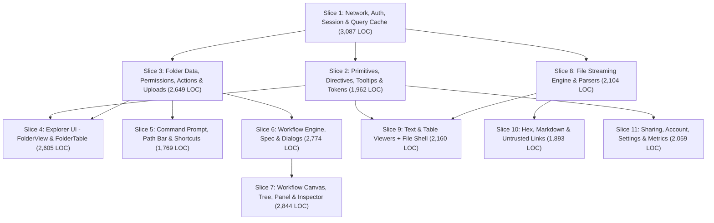

# Code Review Plan (`ponytail-review`)

Self-contained plan for reviewing the entire repository with `/ponytail:ponytail-review` across **11 end-to-end data-flow slices**. Each slice is small enough (1,769–3,087 production lines) for an agent and human to read every file, its callers, and its tests in full in a single session without skimming.

Baseline at `9c1a37d` (2026-11-12): **169 production files (25,906 lines)** and **147 Vitest test files (27,930 lines, 967 tests, 98.6% V8 line coverage)** under `src/`.

---

## 1. Load, Rubric & Guardrails

### Assumed Load

Forensics operators working over high-latency or lossy VPN and Wi-Fi links against a shared OpenRelik server where multiple operators upload evidence and run workers concurrently. Data includes multi-gigabyte disk images, CSV/TSV/JSONL timelines with tens of thousands of rows, untrusted/hostile evidence files and worker Markdown reports, and folders or workflows with hundreds of items.

### Priority Order (`ponytail-review`)

Review every slice like the senior developer who will be paged when it breaks:

1. **Correct:** Bugs, crashes, missed edge cases (0-byte or >1 GB files, empty folders, stale state across `await`, chunk boundaries, rounding/timezones), or callers disagreeing with a function's contract.
2. **Safe:** Hostile evidence and worker reports rendered strictly as text (zero `v-html`, links carry no `href` and go through `LinkMenu.vue`, control and undecodable bytes escaped, HTML shown as source); auth, CSRF, 401 refresh, and complete state wipe on sign-out; no swallowed write errors.
3. **Holds under load:** Slow/flaky network behaviour, memory or maps that only grow, check-then-write races, duplicate requests, `O(n^2)` work on large listings or files.
4. **Tested:** Risky branches, parsers, security boundaries, and mutations have a test that fails when broken (mocking `@/api`, not internal composables where avoidable). Keep touched runtime files at `>= 85%` V8 line coverage (`AGENTS.md` §6).
5. **Fast:** No request waterfalls, no whole-file reads, `O(visible)` windowed rendering.
6. **Lean:** Delete dead code, unused options, and speculative abstractions; reuse existing helpers in `src/utils/`, `src/composables/`, and `src/components/base/`; merge near-copies that must change together; split functions or components **by job** — never by arbitrary line count.

### Non-Negotiable Architecture Rules

Never trade away any of these for a shorter file (`AGENTS.md` §1, [`design-system.md`](design-system.md), [`style-guide.md`](style-guide.md)):

- **Untrusted content:** Zero `v-html`; links mediated by `LinkMenu.vue`; escaped control/invalid bytes.
- **Slow connections:** Reads go through `useQueryCache` (`ensure()`), stale-while-revalidate (with folder-entry listing revalidation), `AbortSignal` cancellation, prefetches skipped offline or on constrained links, mutations written into normalized stores (`items`, `rootPages`, `workflows`).
- **Bounded memory & DOM:** Byte-range reads (`api.files.readRange`) and fixed-height row windowing (`useRowScroller`); streaming downloads (`useDownload`).
- **Uploads:** Chunks of a single file go strictly one after another (`useUploadQueue`).
- **Zero new runtime dependencies.**

---

## 2. How Each Slice Runs

Each slice follows a 4-step loop on branch `review/sNN-<slug>`:

1. **Read the full flow (no edits):** Read every production file listed in the slice, grep callers across `src/` for any exported symbol whose contract is in question, and read the matching `__tests__/*.test.ts` files.
2. **Report (`/ponytail:ponytail-review` format, plain English):**
   - Start with `What this slice does:` (2–3 sentences) and the assumed load.
   - Group numbered findings (`1..N` across the whole report) under **Must fix**, **Should fix**, and **Nice to have** (skip empty groups). Every finding must have a concrete trigger case (_"this input or timing leads to this wrong result or bloat"_) and four short parts: **What this is**, **Problem**, **Fix**, **If we skip it**.
   - Respect `shortcut: <limit>, <when to upgrade>` comments unless the assumed load already crosses the limit. No style taste or vague worries.
   - End with `Verdict:`, `Lean: -<N> lines possible.`, and `Not checked:`.
3. **Triage:** The human replies with the numbers to apply (e.g. `"fix 1, 3, 5"` or `"skip 4, fix the rest"`). Accepted limits get a one-line `shortcut: <limit>, <when to upgrade>` comment in code.
4. **Commit & verify:**
   - **Bug / safety fixes:** Separate `Fix: <area>: <what changed>` commit with a regression test that fails without the fix.
   - **Lean / refactor changes:** Separate commit(s) where existing behaviour tests pass unchanged; any new module extracted by job gets `src/<area>/__tests__/<module>.test.ts` (`>= 85%` V8 line coverage).
   - Run `npm run check` after every commit, plus `npm run test:coverage` and `npm run build` before fast-forwarding `main`. When UI or network behaviour changes, verify in `npm run dev` (including DevTools **Slow 4G** and **Offline**).
   - Update [`src/composables/README.md`](../src/composables/README.md) (including undocumented composables in the slice) and [`AGENTS.md`](../AGENTS.md) if contracts change, then record the result in §5.

---

## 3. Slice Order & Dependencies

Foundations run first (Slices 1–2) so shared contracts settle before feature slices consume them. After Slices 2 and 3, feature tracks can run in any order that respects the arrows below.

|  #  | Slice                                           |   Files |   Prod LOC | Risk |
| :-: | :---------------------------------------------- | ------: | ---------: | :--: |
|  1  | Network, Auth, Session & Query Cache            |      33 |      3,087 | High |
|  2  | Primitives, Directives, Tooltips & Tokens       |      27 |      1,962 | Med  |
|  3  | Folder Data, Permissions, Actions & Uploads     |      19 |      2,649 | High |
|  4  | Explorer UI (`FolderView` & `FolderTable`)      |      10 |      2,605 | Med  |
|  5  | Command Prompt, Path Bar & Global Shortcuts     |      12 |      1,769 | Med  |
|  6  | Workflow Engine, Spec & Picker/Report Dialogs   |      18 |      2,774 | High |
|  7  | Workflow Canvas, Tree, Panel & Inspector        |       8 |      2,844 | Med  |
|  8  | File Streaming Engine & Parsers                 |      14 |      2,104 | High |
|  9  | Text & Table Viewers + File Shell               |       9 |      2,160 | Med  |
| 10  | Hex, Markdown & Untrusted Links                 |       9 |      1,893 | High |
| 11  | Sharing, Account, Settings & Metrics            |      10 |      2,059 | Low  |
|     | **Total (100% of non-test files under `src/`)** | **169** | **25,906** |      |

---

## 4. The 11 Slices

### Slice 1 — Network, Auth, Session & Query Cache (33 files, 3,087 lines)

- **Files:** `src/api/{client,config,errors,index,session,types}.ts`, `src/api/endpoints/{auth,configs,directory,files,folders,metrics,taskqueue,users,workflows}.ts`, `src/composables/{useAutoRefresh,useConnection,useDelayedFlag,useNetworkActivity,useQueryCache,useRemembered}.ts`, `src/stores/{auth,items,modals,rootPages,settings,workflows}.ts`, `src/{main.ts,App.vue}`, `src/router/index.ts`, `src/views/{LoginView,NotFoundView}.vue`, `src/utils/id.ts`.
- **Flow:** Browser storage and `fetch`/XHR client → typed endpoints → CSRF & 401 refresh/redirect → `useQueryCache` freshness/dedup → normalized Pinia stores → router auth/case guard and `LoginView`.
- **Check closely:**
  - `stores/auth.ts` (`setUser(null)`) + `main.ts` (`onUnauthorized`): verify **all** module-scoped state, active timers, modals, and pending saves across the app clear when a 401 drops the session without a full page reload (`router.push('/login')`).
  - `api/client.ts`: 401 refresh race under parallel requests, stale CSRF retry on mutating calls, timeout vs caller `AbortSignal` attribution, and `undefined as unknown as T` on empty responses.
  - `useQueryCache.ts`: waiter counting, abort-on-last-leave, `invalidate()` while a request is in flight, and `MAX_ENTRIES` eviction safety.
- **Verify:** `npm run check`; login/logout, 401 session expiry redirect, revisit within 30 s = 0 extra requests, DevTools **Slow 4G** and **Offline** recovery, sign out then sign in as another user shows zero stale state.

### Slice 2 — Primitives, Directives, Tooltips & Design Tokens (27 files, 1,962 lines)

- **Files:** `src/components/base/{Button,CopyValue,KeyHint,KeyValueRow,LoadState,PanelResizeHandle,PanelToggle,SlidePane,Switch,Tooltip,UserAvatar}.vue`, `src/components/icons/index.ts`, `src/directives/{autofocus,clickOutside,copyToClipboard,index,overflowTooltip,scrollIntoView,tooltip,trapFocus}.ts`, `src/composables/{usePanelWidth,useTooltip}.ts`, `src/utils/{breakable,format,placement,scroll}.ts`, `src/assets/main.css`.
- **Flow:** Design tokens in `main.css` → base UI primitives, positioning/formatting helpers, and global DOM directives mounted everywhere.
- **Check closely:**
  - Inventory reusable helpers here first so Slices 3–11 reuse them instead of keeping private copies.
  - `useTooltip.ts` (9 timers across cold delay, warm window, grace, flash): verify no leaked timers on unmount/navigation and clean `Escape`/scroll dismissal.
  - `directives/copyToClipboard.ts` (160 lines), `overflowTooltip.ts`, `trapFocus.ts`, `scrollIntoView.ts`: listener/observer cleanup on unmount and `Button.vue` type enforcement (5 variants, 2 heights).
- **Verify:** `npm run check`; tooltips (hover, focus, truncated text), clipboard copy feedback, modal focus trap, `SlidePane` transitions, light and dark themes.

### Slice 3 — Folder Data, Permissions, Actions & Uploads (19 files, 2,649 lines)

- **Files:** `src/composables/{useCaseRef,useConfirm,useDownload,useDropZone,useFolderActions,useFolderLoader,useFolderPermissions,useFolderPrefetch,useFolderSearch,useItemActions,useRootPager,useUploadPanel,useUploadQueue}.ts`, `src/components/dialogs/ConfirmDialog.vue`, `src/components/layout/UploadQueuePanel.vue`, `src/types/item.ts`, `src/utils/{caseRef,item,upload}.ts`.
- **Flow:** Route/pager params → `useFolderLoader` & `useRootPager` → role checks (`useFolderPermissions`) → `useFolderActions` / `useItemActions` → drag-and-drop (`useDropZone`) and sequential chunked XHR uploads (`useUploadQueue`).
- **Check closely:**
  - `useUploadQueue.ts` (474 lines): strict single-chunk-in-flight invariant per file, 503 backoff, 429 fresh-ID restart, offline pause/reconnect resume, 0-byte file rejection, 500-file drop cap, and parallel `uploads` / `controllers` / `running` maps.
  - `useFolderActions.ts` (325 lines): optimistic create/rename rollback when concurrent edits or route changes happen mid-flight.
  - `useItemActions.ts` + `useFolderPermissions.ts`: role restrictions (`Viewer` vs `Editor` vs `Owner`) consistently hiding forbidden actions; misplaced `connectionIsConstrained` import between `useFolderPrefetch` and `useUploadQueue`.
- **Verify:** `npm run check`; root paging, folder entry revalidation, create/rename/delete rollback on error, multi-file and nested-folder drop upload, mid-upload **Offline** → reconnect resume, cancel.

### Slice 4 — Explorer UI (`FolderView` & `FolderTable`) (10 files, 2,605 lines)

- **Files:** `src/views/FolderView.vue`, `src/components/folders/{CaseRefPopover,FolderPager,FolderStatusBar,FolderTable,FolderToolbar,ItemMenu,UploadRow}.vue`, `src/composables/{useGroupStacks,useRowSelection}.ts`.
- **Flow:** Explorer page orchestration (`FolderView`) → toolbar, table rows, upload rows, grouped stacks, selection, context menu, pager, and status bar.
- **Check closely:**
  - `FolderView.vue` (936 lines) and `FolderTable.vue` (842 lines): identify distinct jobs mixed in script setup (keyboard navigation, inline rename state, drag-over handling, workflow side-pane coordination) and split by job where it removes real coupling.
  - `useRowSelection.ts` & `useGroupStacks.ts`: range selection (`Shift+Click` / `Shift+j/k`) when background refresh inserts or removes rows, and stack expand/collapse keyboard parity.
  - Escape hierarchy: inline rename → context menu / popover → selection clear, without side effects.
- **Verify:** `npm run check`; `j`/`k`/`Enter`/`l`/`Escape` layers, `Shift` and `Cmd/Ctrl` multi-select, inline rename, row menu vs selection bar parity, `.tabular` alignment.

### Slice 5 — Command Prompt, Path Bar & Global Shortcuts (12 files, 1,769 lines)

- **Files:** `src/composables/{useHelp,useKeyboardShortcuts,usePrompt}.ts`, `src/components/prompt/{Prompt,PromptResults}.vue`, `src/components/layout/{BrandLink,PathBar,SettingsTrigger,StatusBar}.vue`, `src/components/dialogs/HelpDialog.vue`, `src/utils/{keyboard,match}.ts`.
- **Flow:** Window keydown (`useKeyboardShortcuts`) / `PathBar` / `Prompt` input → command & path parsing + local/remote fuzzy search (`usePrompt`, `match.ts`) → navigation or folder mutation.
- **Check closely:**
  - `usePrompt.ts` (545 lines): `PromptResult` uses ~10 optional boolean flags (`up`, `here`, `home`, `prev`, `mkdir`, `rm`, `remote`, …) — convert to a discriminated union if it simplifies dispatch and eliminates impossible states; check separation between pure command parsing and side-effecting execution.
  - `PathBar.vue` (380 lines, 4 `nextTick`s): focus/blur races with `Prompt.vue` and `modalStore.registerPrompt`.
  - `useKeyboardShortcuts.ts` + `HelpDialog.vue`: `isTyping()` protection and complete shortcut listing.
- **Verify:** `npm run check`; `Cmd/Ctrl+K`, `g`, `?`, `cd`, `..`, `-`, `mkdir`, `rm`, `/case/…`, Tab completion, remote search debounce/cancel, `Escape` handling.

### Slice 6 — Workflow Engine, Spec & Picker/Report Dialogs (18 files, 2,774 lines)

- **Files:** `src/composables/{useRun,useTaskReport,useWorkers,useWorkflow,useWorkflowDialog,useWorkflowLoader,useWorkflowTemplates}.ts`, `src/stores/run.ts`, `src/utils/{report,worker,workflow,workflowSpec}.ts`, `src/types/{worker,workflow}.ts`, `src/components/dialogs/{RunDialog,TaskReportDialog,WorkflowDialog}.vue`, `src/components/reports/PriorityBadge.vue`.
- **Flow:** Worker registry & templates → `RunDialog` / `WorkflowDialog` → `useWorkflow` draft edits, debounced single-flight `PATCH` coalescing, undo, and `runWorkflow` → `useWorkflowLoader` 3 s background polling & output folder revalidation → `TaskReportDialog`.
- **Check closely:**
  - `useWorkflow.ts` (792 lines): module-scoped `activity`, `unsaved`, `saveTimers`, `saves`, `runs` lifecycle on sign-out or folder deletion; race between an in-flight `PATCH`, new local edits, and `runWorkflow()`; inverse-op undo correctness vs spec snapshot.
  - `utils/workflowSpec.ts` & `utils/workflow.ts`: Celery chord/chain round-tripping (`tasksFromSpec` ↔ `specFromTasks`), `runBlocker()` validation, and duplicate task UUID avoidance.
  - `useWorkflowLoader.ts`: polling skips overlapping ticks, stops on unmount or completion, and refreshes folder outputs as each task finishes.
- **Verify:** `npm run check`; create workflow, add/remove/join/split/merge tasks + undo, rapid edits on **Slow 4G** coalesce cleanly, run workflow, poll to completion, view task report, save/apply template.

### Slice 7 — Workflow Canvas, Tree, Panel & Inspector (8 files, 2,844 lines)

- **Files:** `src/components/workflow/{TaskInspector,TaskRunningIcon,TaskStatusBadge,TaskStatusIcon,WorkflowGraph,WorkflowPanel,WorkflowSummary,WorkflowTree}.vue`.
- **Flow:** `Workflow` state → `WorkflowPanel` side pane, `WorkflowGraph` DAG/chord canvas, `WorkflowTree` outline, and `TaskInspector` option editor.
- **Check closely:**
  - `WorkflowGraph.vue` (1,412 lines): check layout math edge cases (empty draft, wide fan-out, nested chords, long worker names) and whether pure graph layout belongs in `src/utils/` with direct unit tests, separated from pointer/keyboard state and template rendering.
  - Consistency between `WorkflowGraph.vue` and `WorkflowTree.vue`: task status icons, "won't run" state after upstream failure, selection sync, and `AddAt` insertion affordances.
  - `TaskInspector.vue`: dynamic worker config inputs (boolean, integer, string, select) writing cleanly through `setTaskOption`.
- **Verify:** `npm run check`; workflows with 0, 1, 5, and 30+ tasks, parallel groups and chords, upstream failure status propagation, keyboard navigation, light/dark contrast, panel resize.

### Slice 8 — File Streaming Engine & Parsers (14 files, 2,104 lines)

- **Files:** `src/composables/{useByteChunks,useFileDetails,useMarkedRange,useRangeText,useRowScroller,useTableStream,useTextSearch,useTextStream}.ts`, `src/utils/{bytes,lines,marks,preview,table,textSearch}.ts`.
- **Flow:** `api.files.readRange` → 64 KiB byte chunk LRU (`useByteChunks`) & streaming UTF-8 range decoder (`useRangeText`) → incremental line/CSV/TSV/JSONL streams (`useTextStream`, `useTableStream`, `lines.ts`, `table.ts`), incremental search (`useTextSearch`), URL mark parsing (`marks.ts`, `useMarkedRange`), and virtual row windowing (`useRowScroller`).
- **Check closely:**
  - Multi-byte UTF-8 sequences and `\r\n` split across arbitrary byte/chunk boundaries in `useRangeText.ts`, `lines.ts`, and `table.ts`.
  - `utils/table.ts`: quoted fields containing delimiters, escaped quotes (`""`), embedded newlines, headerless CSV, ragged column counts, and malformed JSONL lines.
  - `useByteChunks.ts`, `useTextStream.ts`, `useTableStream.ts`, `useTextSearch.ts`: memory bounds on >1 GB files, `forgetTextFiles()` / `reset()` cleanup, `AbortSignal` cancellation on rapid scrolling or file switch, and 0-byte file handling.
- **Verify:** `npm run check`; chunk-boundary streaming tests, 0-byte file, >1 GB file scroll-to-end without unbounded memory growth, forward/backward search, `#L12-L40` mark parsing.

### Slice 9 — Text & Table Viewers + File Shell (9 files, 2,160 lines)

- **Files:** `src/views/FileView.vue`, `src/components/viewers/{FileContent,FileDetails,FileSidePanel,TableDetail,TableViewer,TextRow,TextSearchBar,TextViewer}.vue`.
- **Flow:** `/folder/:folderId/file/:fileId` (`FileView`) → viewer selection (`FileContent`) + metadata side pane (`FileSidePanel`, `FileDetails`) → windowed `TextViewer` and `TableViewer`.
- **Check closely:**
  - `TextViewer.vue` (664 lines) and `TableViewer.vue` (611 lines): URL hash mark sync (`#L…`), CSS Custom Highlight API fallback/cleanup, selection vs marked-line interaction, line-wrap height/scroll behaviour, column resize, and duplicated viewer boilerplate across viewers.
  - Control-character escaping in `TextRow.vue`, `TableViewer.vue`, and `TableDetail.vue`.
- **Verify:** `npm run check`; text and CSV/TSV/JSONL viewing, search bar navigation, `#L12-L40` URL sharing and reload, copy rows/ranges, side panel metadata copy.

### Slice 10 — Hex, Markdown & Untrusted Links (9 files, 1,893 lines)

- **Files:** `src/components/viewers/{HexInspector,HexViewer,MarkdownViewer}.vue`, `src/components/markdown/{LinkMenu,MarkdownInline,MarkdownView}.vue`, `src/composables/useLinkMenu.ts`, `src/utils/{links,markdown}.ts`.
- **Flow:** Raw evidence bytes → `HexViewer` + `HexInspector` decoders; untrusted file/report text → `utils/markdown.ts` AST → `MarkdownView` / `MarkdownInline` text components → `useLinkMenu` + `utils/links.ts` + `LinkMenu.vue`.
- **Check closely (Forensics Safety):**
  - `utils/markdown.ts` (310 lines) + `MarkdownView.vue` + `MarkdownInline.vue`: confirm no input can produce active markup, clickable `href`, auto-loaded images, or regex catastrophic backtracking / unbounded recursion on crafted inputs.
  - `utils/links.ts` + `LinkMenu.vue`: dangerous schemes (`javascript:`, `data:`, `vbscript:`, `file:`), deceptive punycode/IDN hosts, `@` userinfo spoofing, and bidi/control characters in displayed URLs.
  - `HexViewer.vue` (596 lines) + `HexInspector.vue` (154 lines) + `utils/bytes.ts` callers: endianness, integer/timestamp bounds, DOS local-time labelling, and selection/copy offsets at EOF.
- **Verify:** `npm run check`; hostile Markdown inputs (raw HTML, `javascript:` links, punycode URLs, control chars, deeply nested lists/quotes, images), hex inspection and copy across chunk boundaries.

### Slice 11 — Sharing, Account, Settings & Metrics (10 files, 2,059 lines)

- **Files:** `src/components/dialogs/{AccountDialog,SettingsDialog,ShareDialog}.vue`, `src/composables/{useApiKeys,useSettings,useShareDialog}.ts`, `src/views/MetricsView.vue`, `src/components/metrics/MetricCard.vue`, `src/components/charts/LineChart.vue`, `src/utils/chart.ts`.
- **Flow:** Folder sharing & role edits (`ShareDialog`, `useShareDialog`), account profile & API keys (`AccountDialog`, `useApiKeys`), persisted preferences (`SettingsDialog`, `useSettings`), and server metrics charts (`MetricsView`, `MetricCard`, `LineChart`, `chart.ts`).
- **Check closely:**
  - `ShareDialog.vue` (531 lines) + `useShareDialog.ts` (254 lines): state split between component and composable, concurrent role/remove mutations, directory search debounce/cancel, and cache invalidation of `useFolderPermissions` after role changes.
  - `AccountDialog.vue` + `useApiKeys.ts`: newly minted API key secret cleared when dialog closes or user signs out.
  - `utils/chart.ts` + `LineChart.vue`: division-by-zero / `NaN` SVG paths on 0, 1, or flat data points, and `.tabular` formatting.
- **Verify:** `npm run check`; add/change/remove user and group shares, create/copy/revoke API key, theme/density/page-size persistence, `/metrics` with empty, single-point, and full series.

---

## 5. Progress

|  #  | Slice                                         | Status  | Branch / Commits | Fixes | Lean Δ | Notes |
| :-: | :-------------------------------------------- | :-----: | :--------------- | :---: | -----: | :---- |
|  1  | Network, Auth, Session & Query Cache          |  Done   | `review/s01-network-auth-cache` (`60419dc`..`8b36e97`) |  10   |  -131  | Session cleanup on 401; 401 retry/abort/body-timeout recovery; `markRaw` `AbortController` + `markFresh`/listener fixes; safe login redirects + `/case` error retry; indexed `upsertItems` + validated settings; `id.test.ts`; removed dead `configs` & store helpers (`98.55%` line cov, build green; manual live-server Slow 4G/Offline not checked). |
|  2  | Primitives, Directives, Tooltips & Tokens     | Pending | —                |   —   |      — |       |
|  3  | Folder Data, Permissions, Actions & Uploads   | Pending | —                |   —   |      — |       |
|  4  | Explorer UI (`FolderView` & `FolderTable`)    | Pending | —                |   —   |      — |       |
|  5  | Command Prompt, Path Bar & Global Shortcuts   | Pending | —                |   —   |      — |       |
|  6  | Workflow Engine, Spec & Picker/Report Dialogs | Pending | —                |   —   |      — |       |
|  7  | Workflow Canvas, Tree, Panel & Inspector      | Pending | —                |   —   |      — |       |
|  8  | File Streaming Engine & Parsers               | Pending | —                |   —   |      — |       |
|  9  | Text & Table Viewers + File Shell             | Pending | —                |   —   |      — |       |
| 10  | Hex, Markdown & Untrusted Links               | Pending | —                |   —   |      — |       |
| 11  | Sharing, Account, Settings & Metrics          | Pending | —                |   —   |      — |       |
